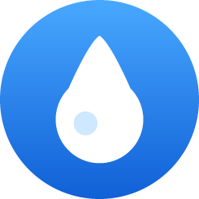

# Marca d'Água 💧

Lembrete de água para o **Amazfit Bip Max** (Zepp OS 5, tela quadrada 432×514).

Você escolhe um intervalo (ex.: 1 h) e o relógio avisa, vibra e **recomeça o timer sozinho**, sem precisar tocar em nada e sem criar alarmes.



## Como funciona

- **Tela principal:** um círculo com água que vai **esvaziando** até a hora de beber, uma gota no centro e a contagem regressiva embaixo.
- **Deslize para cima** (ou toque em "Ajustes") para configurar:
  - **Intervalo:** de 5 min a 4 h.
  - **Dias da semana:** D S T Q Q S S (azul = ativo).
  - **Início e fim dos avisos:** em passos de 30 min.
  - **Ligar/desligar** os avisos.
- **Aviso:** uma notificação "Hora de beber água!" com vibração. O próximo ciclo começa na hora, mesmo que você não veja o aviso.
- **Mudanças nos ajustes:** o ciclo recomeça a partir do momento em que você salva. Nos dias seguintes, ele começa no horário de início.

### Por dentro

| Arquivo | Função |
|---|---|
| `utils/schedule.js` | Lógica pura: calcula o próximo aviso (janela de horário, dias, intervalo). Tem testes. |
| `utils/alarm.js` | Agenda um alarme único (`@zos/alarm`) que acorda o serviço. A configuração vai no `param` do alarme. |
| `app-service/reminder.js` | Serviço sem tela: envia a notificação e agenda o próximo alarme (encadeado). |
| `page/index.js` | Tela com o círculo de água (animação só com o app aberto). |
| `page/settings.js` | Tela de ajustes. Salvar ou voltar já reagenda. |
| `scripts/gen-icons.mjs` | Gera o ícone e a gota em PNG, sem dependências. |

Ao abrir o app, o alarme é sempre reagendado. Se a corrente de alarmes quebrar por algum motivo (por exemplo, relógio desligado), abrir o app conserta.

## Limitações

- A animação só roda com o app aberto. Em segundo plano roda apenas o alarme, o que economiza bateria.
- Nos modos **Não Perturbe** e **sono**, o sistema pode silenciar a vibração.
- Os horários de início e fim são do mesmo dia (não atravessam a meia-noite).

## Rodar e instalar

Pré-requisitos: Node.js 18 ou mais novo e o [Zeus CLI](https://docs.zepp.com/docs/guides/tools/cli/).

```bash
npm install -g @zeppos/zeus-cli
```

```bash
npm install
```

Testes da lógica de agendamento:

```bash
npm test
```

Simulador (instale o [Zepp OS Simulator](https://docs.zepp.com/docs/guides/tools/simulator/) e escolha o Bip Max):

```bash
zeus dev
```

**No relógio de verdade:**

1. Crie uma conta gratuita em [console.zepp.com](https://console.zepp.com).
2. No app Zepp do celular, ative o Modo Desenvolvedor: Perfil → Configurações → Sobre → toque 7× no ícone do Zepp.
3. Faça login no Zeus e gere o QR code:

   ```bash
   zeus login
   ```

   ```bash
   zeus preview
   ```

4. No app Zepp, vá em Perfil → Modo Desenvolvedor → Escanear e leia o QR code.

> Se o `zeus preview` reclamar do `appId`, crie um app no console da Zepp e troque o `appId` em `app.json` pelo número gerado.

Para testar rápido, configure o intervalo de 5 min, feche o app e espere a notificação.

## Ícones

```bash
npm run icons
```

Isso regenera `assets/gt.s` (tela quadrada) e `assets/gt.r` (tela redonda).

## Licença

MIT
